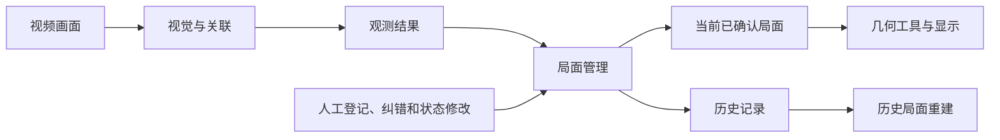

# 项目架构草案 v1

日期：2026-10-22  
状态：讨论草案，尚未实现；技术选型与详细接口待继续讨论。  
需求依据：[[Product Requirements v3]]。

## 1. 目标与已确认决定

围绕“有独立身份、可修改、可回放的数字棋盘”组织系统，支持视觉识别、交互叠加、几何工具、假设推演和历史回放。

- 每支实际部队保留独立 ID、位置、状态和历史。同兵种单位可以共享类型配置与外观参考。
- 第一版由解说员手动修改 Damage、Wavering、Routed 等动态状态，并手动移除单位。
- 第一版不实现自动战斗结算引擎；几何与规则模块先负责测距、移动范围和基础 LOS。
- 使用通用预训练 DINOv2 特征，不要求预先认识固定兵种；本场登记应适用于陌生或 DIY 单位。
- 追踪与恢复的最终算法通过小规模视频实验选择。SAM＋DINO、局部特征匹配和轻量追踪基线仍是候选路线。

## 2. 总体组织

建议采用一个本地应用，内部按职责拆分模块，通过明确的数据结构和接口协作。

纯脚本适合独立验证算法；多个独立服务会增加部署和通信工作。当前优先使用一个应用，保留替换视觉算法、几何算法和界面的能力。是否需要拆进程以及具体框架，留待性能实验与交互原型决定。

| 模块 | 职责 | 输出 |
| --- | --- | --- |
| 战场标定 | 检测与确认棋盘四角、登记实际尺寸、建立透视映射、检查变化并重新标定 | 有版本的图像—棋盘坐标转换 |
| 视觉与关联 | SAM 候选、DINO 特征、追踪、身份配对、托盘占地和朝向估计 | 带时间、置信度和来源的观测结果 |
| 局面管理 | 单位登记、接受可靠观测、处理纠错、人工状态修改与移除 | 当前已确认局面 |
| 几何与规则 | 托盘距离、移动范围、基础 LOS，以及所需属性是否齐备 | 计算结果、适用条件和不确定性 |
| 历史记录 | 保存已确认的位置、状态和配置变化，重建历史局面 | 回放所需的局面 |
| 交互与显示 | 登记、选择、高亮、图层、状态编辑、推演与回放控制 | 用户操作与画面 |

## 3. 视觉观测与已确认局面分开

SAM 找到区域、DINO 给出相似度，仅代表一次视觉观测。候选可能是杂物、重复检测或身份不明的目标，不能直接覆盖已确认局面。

视觉模块提交的观测信息应包含：

- 视频时间或帧号。
- 候选 box 或 mask。
- 棋盘位置、托盘占地与朝向的估计，以及各自是否可靠。
- 可能对应的类型或单位身份。
- 置信度、相关遮挡情况与观测来源。
- 使用的标定版本。

局面管理模块决定更新哪个单位，或保留未知、缺失与不确定状态。失踪单位仍保留其 ID 与最后确认位置；最后确认位置不能显示成当前实测位置。

视觉算法通过统一观测接口接入。更换追踪或恢复路线时，局面管理、历史与几何模块不必同时重写。

## 4. 实况、推演、回放使用独立的局面

| 模式 | 数据来源 | 用户操作的影响 |
| --- | --- | --- |
| 实况 | 当前已确认局面 | 可以纠错、修改状态与移除单位；写入正式历史 |
| 推演 | 某一时刻局面的副本 | 只修改副本；Ctrl＋Z 撤销推演操作；不写入正式历史 |
| 回放 | 根据历史重建的局面 | 修改播放位置、播放状态或速度；不修改实况 |

推演中拖动单位后，测距、移动范围和 LOS 根据推演副本计算。退出推演或回放后，界面重新显示当前实况。

视觉关联与恢复始终依据实况状态，不能使用推演或回放位置去寻找真实单位。

几何模块接受明确的局面作为输入，不直接读取全局实况变量，使三种模式复用同一套计算。

## 5. 核心数据模型

优先细化以下五种数据及其关系：

| 数据 | 内容与职责 |
| --- | --- |
| `UnitType` | 兵种属性、阵型、默认底座尺寸、特殊规则等共享配置 |
| `UnitInstance` | 一支实际部队的独立 ID、阵营、配置覆盖、位置、朝向、动态状态、可见性与最后确认时间 |
| `Observation` | 某一帧看到了什么、可能对应谁，以及相关估计与不确定性 |
| `BoardState` | 某个时刻的单位、地形、标定关联及局面状态；几何工具与显示的输入 |
| `StateEvent` | 某个时刻发生的一次已确认变化，例如移动、人工纠错、伤害修改或移除 |

外观参考单独维护，记录参考图片、特征向量、适用类型及必要来源；不将其混入单位的动态游戏状态。地形记录和标定记录的详细结构随数据模型一起细化。

例如，两支同款骑兵可共享 `UnitType` 和类型外观参考，但各自拥有 `UnitInstance`，分别维护位置、Damage 和移除状态。人工修改 Damage 不需要重新登记外观。

## 6. 几何与规则模块

几何计算使用棋盘平面坐标、托盘占地与朝向，区分模型可见轮廓和真实底座范围。

- 距离：根据选定两单位的底座占地计算最近距离，并返回连接点。
- 移动范围：根据单位属性、支持的命令、地形及其他单位占地计算或采样；有限采样结果注明为估计。
- 基础 LOS：根据位置、朝向、地形与 Height 信息返回 clear、blocked 或 uncertain。
- 工具启用条件由配置与数据完整性决定。例如缺少所需 Height 时，不能给出依赖该属性的 LOS 结论。
- Kings of War 相关计算依据需求中约定的规则范围实现；完整战斗结算不属于第一版范围。

规则计算应与界面、视觉模型解耦。测距、LOS、移动范围分别提供接口，便于单独验证和逐步增加规则覆盖。

## 7. 历史与回放

每次已确认移动、人工状态修改、纠错或移除，都在更新局面时生成对应的历史事件，避免当前状态与记录不一致。

历史事件至少记录：

- 视频时间或帧号，以及事件顺序。
- 涉及的单位 ID。
- 变化内容。
- 自动或人工来源。
- 相关标定版本。

建议结合定期局面快照与后续事件重建历史，以降低拖动时间轴时的重建成本。存储格式和快照频率待确定。

插值只用于显示两个已知位置之间的过渡，不能当作真实走过的路线，也不能写回正式历史。推演操作与回放播放操作同样不写入实况历史。

## 8. 建议的设计顺序与待讨论事项

1. 先确定五种核心数据结构及类型、实际单位、观测、历史之间的关系。
2. 确定观测何时可以成为正式局面变化，以及缺失、不确定和人工纠错的处理规则。
3. 确定实况、推演、回放之间的进入、退出与数据隔离接口。
4. 确定几何工具输入输出，再实现可独立验证的计算。
5. 用小规模视频实验选择视觉路线，通过统一观测接口接入。

仍需细化：

- 如何估计与人工修正托盘占地和前后朝向。
- 自动更新位置的确认时机与置信度策略。
- 视觉结果、人工纠错与较晚到达的观测之间的优先级。
- 历史中如何表示后续发现并纠正的错误。
- 标定变化后哪些观测、几何结果需要重新确认。
- 历史存储、视频素材与外观图库的保存方式。
- 本地界面框架、模型调用接口与实测性能要求。

本文件保存架构讨论结果，不表示上述待选算法、存储方式或框架已确定。
