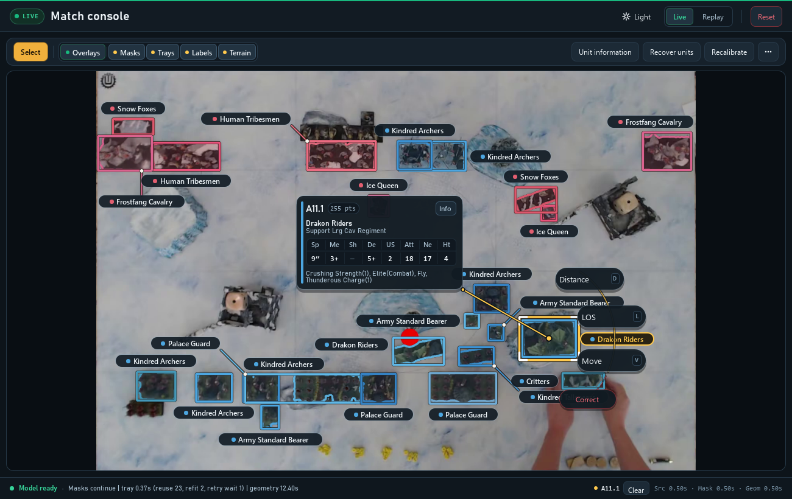
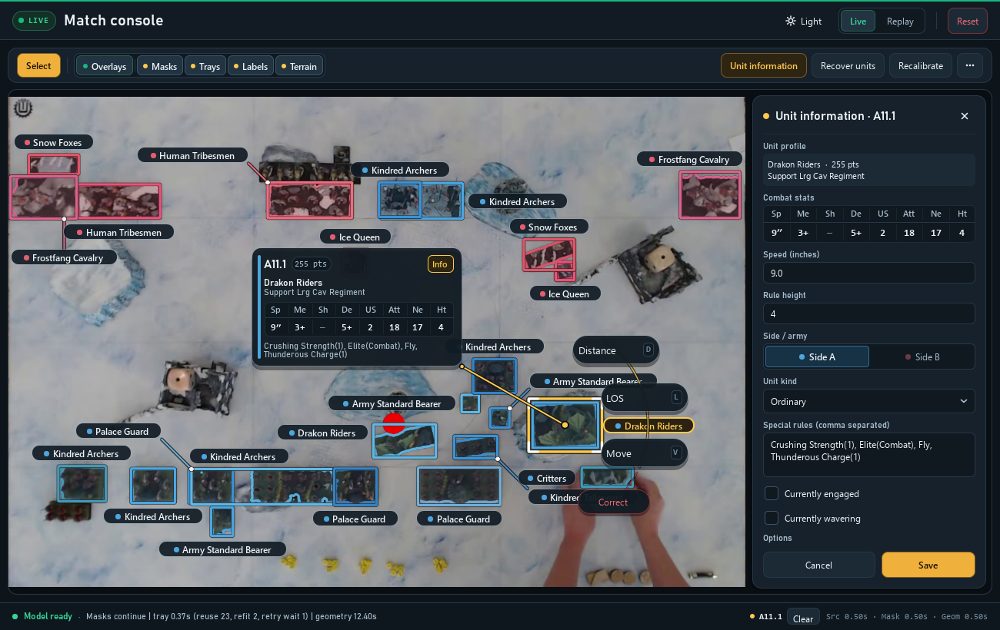
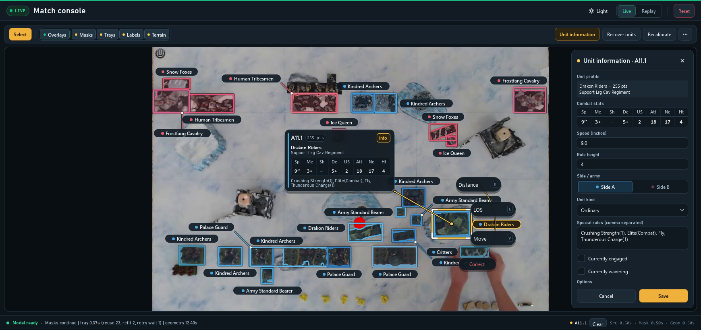
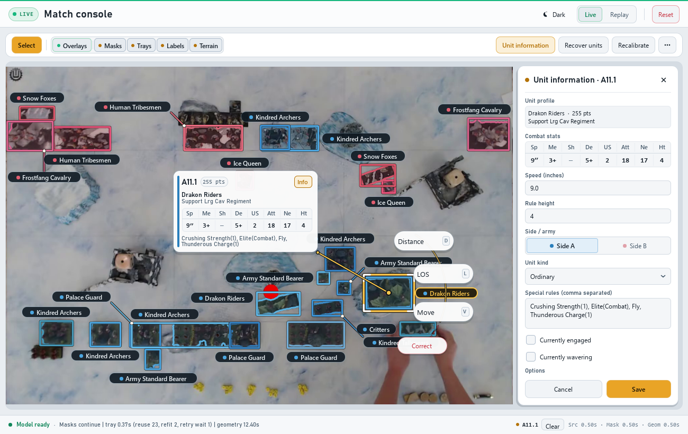
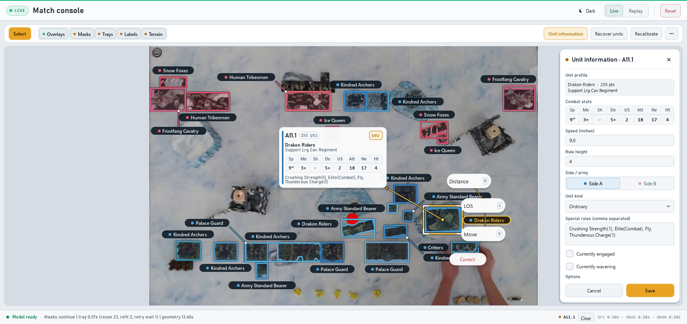
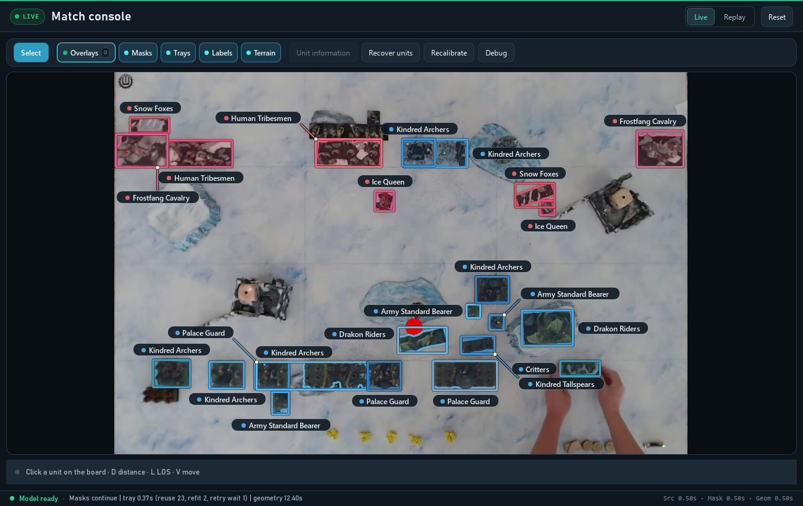
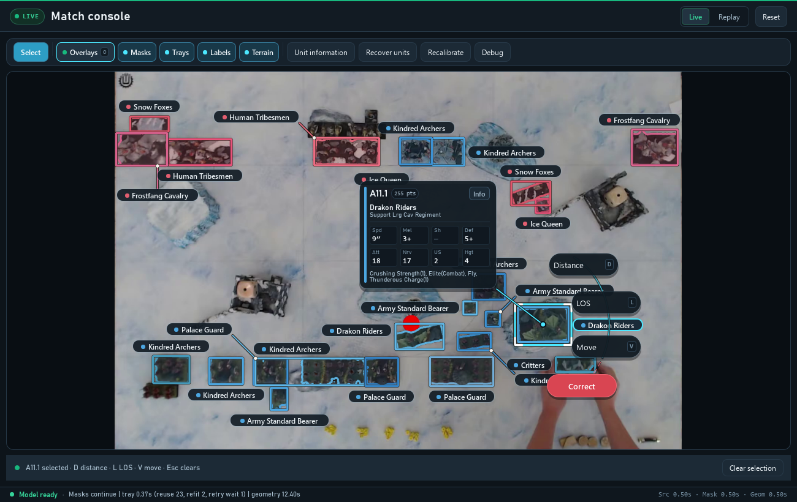
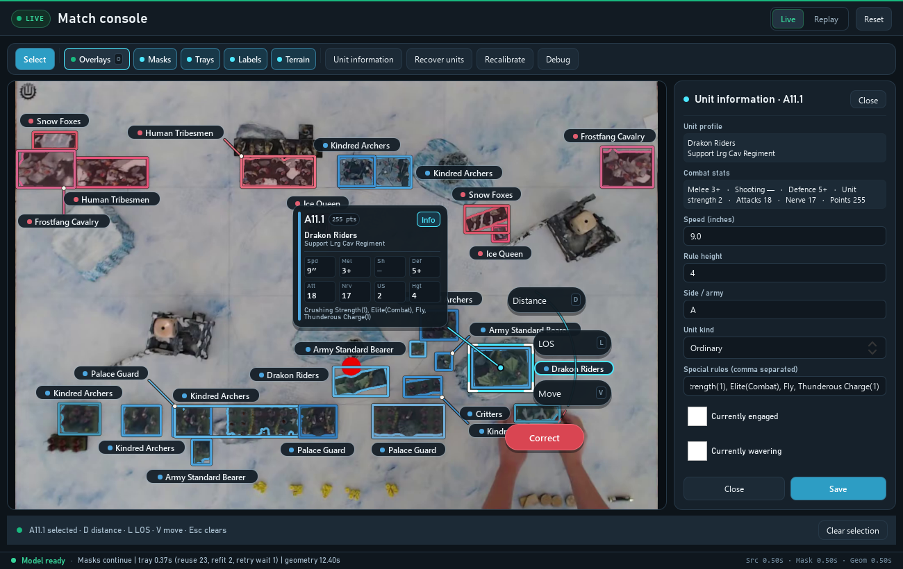
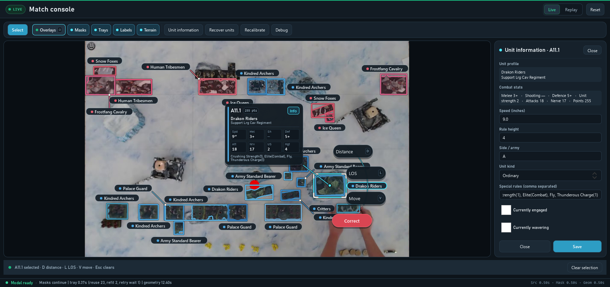

# Qt Live 前端审美评审（2026-11-27）

状态：**已按 2026-11-28 用户决策全部落地并离屏验收**（已同步至 `项目思路.md`、`TODO.md`、`frontend/qt/README.md`）。

### 2026-11-28 用户确认项与落地结果

- **强调色（第 5 条）**：采用暖琥珀色（暗色 `#f0b03c`／`#ffc94d`，亮色 `#e9a426`／`#b47206`），与 A 方蓝／B 方红彻底分离；Replay 迁至紫色、警告迁至橙色。
- **签名方向（第 6、8 条）**：新增共享 `StatStrip.qml`，左卡与右栏统一采用 Kings of War 8 列横排属性条（`Sp Me Sh De US Att Ne Ht`）。
- **深浅色主题切换**：顶部栏新增矢量图标 `Light`／`Dark` 切换按钮（默认深色、不持久化），由 `window.py` `Appearance` 与 `Theme.qml` 实时驱动；画布胶囊名牌双主题均保持深底高对比。
- **其余条目（1–4、7–11）**：新增 `ConsoleCheckBox.qml` 与 `ConsoleComboBox.qml` 替换 Basic 默认控件；弱化半环 `Correct`；右栏停靠优先覆盖黑边（1740 宽 0.0 px 偏移）；`Special rules` 改为多行自动换行 `TextArea`、`Side / army` 改为 A／B 分段选择、底栏改 `Cancel`／`Save`；左卡 `_place_card` 计入邻近名牌占用并加强琥珀引线；工具栏按左侧图层条（移除易误读为 `0` 的 `O` 键帽）与右侧操作分区、`Debug snapshot` 收入 `···` 菜单；顶栏 `Reset` 加分隔线与红框样式；空闲／普通选中态收起底部 `LiveConsole` 提示栏，定高底栏内联 `Clear`。

| 改造后截图 | 内容 |
| --- | --- |
|  | 深色 · 选中 A11.1（1300 宽） |
|  | 深色 · 打开右栏（1300 宽） |
|  | 深色 · 1740 宽右栏（棋盘 0 px 偏移） |
|  | 浅色 · 打开右栏（1300 宽） |
|  | 浅色 · 1740 宽右栏 |

---

## 评审依据

- 渲染方式：离屏 Qt（`QT_QPA_PLATFORM=offscreen`，software 后端），真实 `frontend/qt` QML + `MatchBridge`，假 match 对象。
- 画面：`outputs/sam3_registration/frame_5b58dfca4481` 的 24 单位存档帧与 mask；托盘框用 mask 外接矩形近似。截图中的标签文本、托盘形状与真实运行可能不同，不作为评审对象。
- 窗口：`preview_width=960`（窗口 1300×820）与 `preview_width=1400`（窗口 1740×820）。
- 范围：Live 主界面、左侧浮动单位卡（UnitHud）、半圆菜单、右侧 UnitInfoPanel。Register / Recovery / Replay 未用真实画面评审。

| 截图 | 内容 |
| --- | --- |
|  | Live 空闲，1300 宽 |
|  | 选中 A11.1：左卡 + 半圆菜单 |
|  | 打开右侧 Unit information |
|  | 1740 宽窗口，打开右栏 |

整体结论：框架已较干净，主要问题在**视觉层级**与**少量未换皮的 Qt Basic 默认控件**。

## 高优先级（观感影响最大）

1. **右栏复选框是白色大方块。** "Currently engaged / wavering" 使用 Basic 样式默认指示器，与深色主题冲突，是全屏最突兀的元素。建议：深色底 + 强调色描边 + 勾选标记，或改为 Switch。"Unit kind" 下拉框的上下双箭头同为默认样式，易被误认为数字输入框，建议换成单个下箭头。
2. **Correct 按钮视觉权重过高。** 实心饱和红胶囊比 Distance / LOS / Move 更抢眼，但它是低频纠错操作。建议改为红色描边、缩小，或降低其在菜单中的视觉权重。
3. **打开右栏时棋盘整体左移约 165 px。** 实况追踪中所有单位同时"跳位"，打断注意力。棋盘两侧已有大面积黑边（1740 宽时每侧约 240 px）。建议右栏优先覆盖黑边、棋盘保持不动，空间不足时才压缩棋盘。
4. **Special rules 为单行输入框，内容被截断**（显示为 "trength(1), Elite…"）。建议改为自动换行的多行输入，或按规则拆成标签。

## 中优先级（层级与一致性）

5. **UI 强调色与 A 方阵营色冲突。** Select、Save、Info 与选中高亮均为青蓝色，A 方托盘也是蓝色，选中 A 方单位时高亮难以辨认。建议蓝 / 红仅用于阵营，选中态与主操作改用白色或琥珀色。（涉及全局配色，需用户拍板。）
6. **数值格标签过小、对比度低。** Spd / Mel 等标签约 8 px 灰字，桌边观看难以读清，建议不小于 10–11 px。8 个独立描边小格偏"仪表盘"感、视觉偏重。
7. **左卡与所属单位缺少视觉连接，且会遮挡其他单位标签。** 半圆菜单有引线指向单位，左卡没有；卡片远离单位时归属不明确。截图中 "Ice Queen"、"Archers" 标签被卡片压住。建议加细引线，并在 `_place_card` 采样中把其他单位标签框计为占用。
8. **右栏信息重复。**
   - 顶部与底部各有一个 Close，底部应为 Cancel。
   - Combat stats 为圆点分隔的整段文字，"Unit strength 2" 被折成两行，且与左卡数值格是两套表达。
   - Side / army 用文本框输入 "A"，建议改为 A / B 二选一。
9. **工具栏缺少分组。** 显示开关（Masks / Trays / Labels / Terrain）与操作按钮（Unit information / Recover units / Recalibrate / Debug）样式几乎相同且排成一行。建议加分隔，Debug 收入"更多"菜单。Overlays 后的 "0" 计数含义不明，属于视觉噪音。
10. **Reset 紧邻 Live / Replay 切换，样式权重相同。** 破坏性操作与导航应拉开距离，或以红色描边区分。
11. **底部提示栏与菜单重复。** "D distance · L LOS · V move" 已由菜单按钮上的 D / L / V 键帽表达，却单独占一整行（约 45 px）。可并入状态栏，把高度让给棋盘。

## 可选的"签名"方向

把数值格改为 Kings of War 军表原生的**横排属性行**：表头 `Sp Me Sh De Att Ne US Ht`，下方一行等宽数字。

- 这是玩家最熟悉的格式，与 `components/registration/pdf_reader.py` 解析的 8 个属性列一致。
- 左卡与右栏 Combat stats 可共用同一表达，同时解决第 6、8 条。

## 建议实施顺序

1. 第 1–4 条：纯样式与布局，风险低。
2. 第 7–11 条：交互层级整理。
3. 第 5 条与签名方向：涉及全局配色和数据呈现，先由用户决定。
