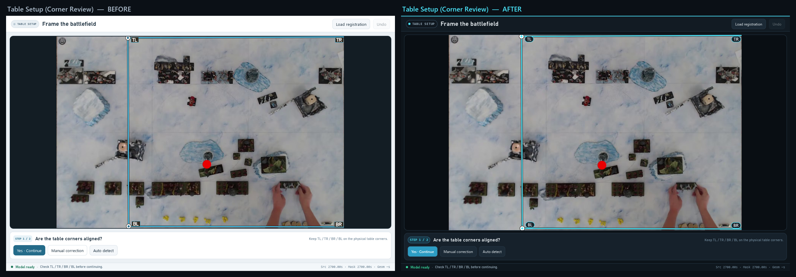
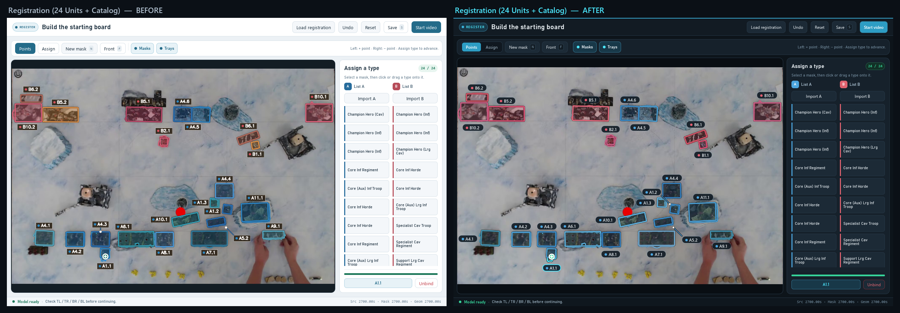
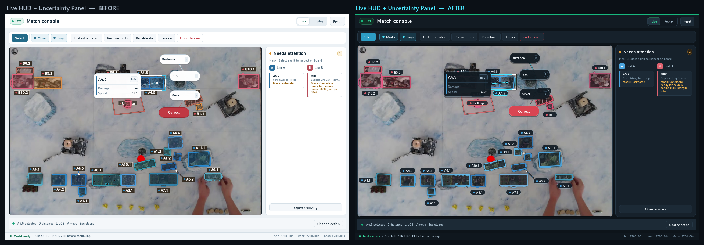
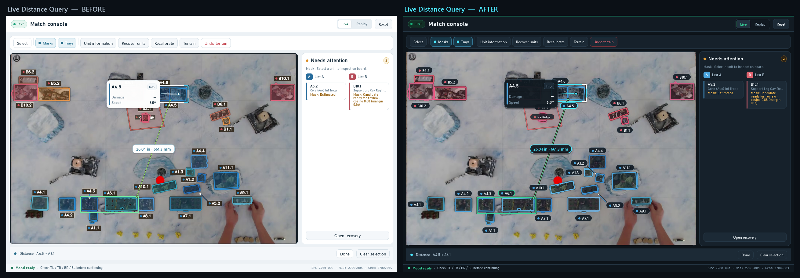
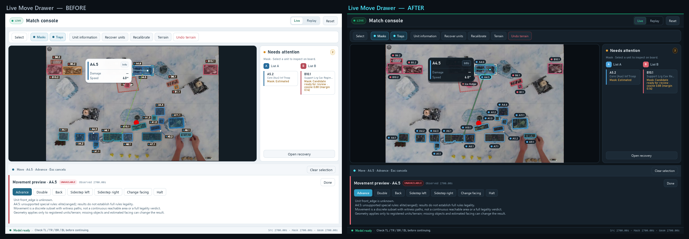
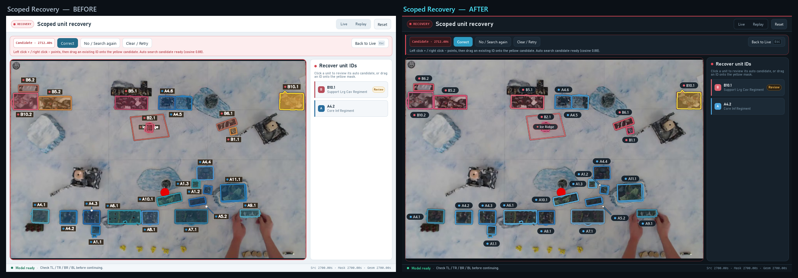
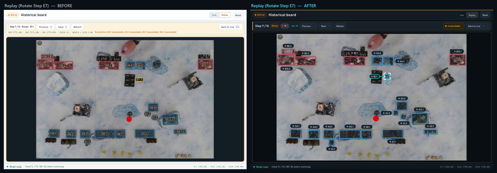
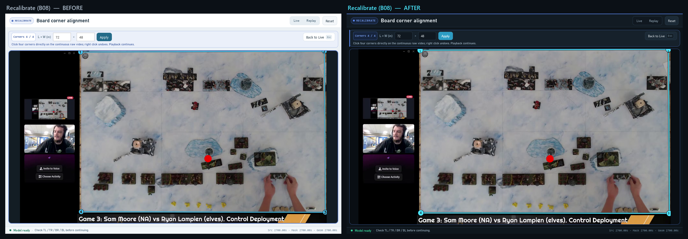
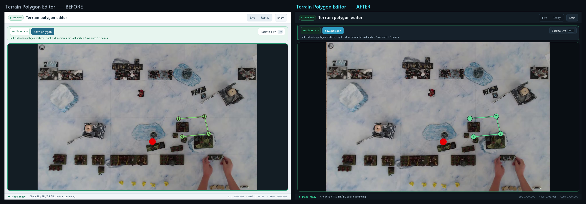

# Qt 前端视觉与交互改造前后对比（Before vs After）

对应代码改动：`frontend/qt/`（及 `frontend/shared/layers.py`），未改动 `application/` 与 `components/` 后端算法。
所有截图均基于 `outputs/sam3_registration/frame_5b58dfca4481` 真实 24 对象存档、真实 `history.sqlite3` 历史事件与真实 `components.game_rules` 几何计算，在 Qt `offscreen` + `software` 下以 `1280×840` 抓取。

- 修改前单张大图：`前端对比截图/before/`
- 修改后单张大图：`前端对比截图/after/`
- 左右并排对比图：`前端对比截图/side_by_side/`

## 改动摘要（对应评价大纲）

1. **统一深色控制台 & 收敛模式边框**：外围界面改为 `#0d141a` → `#16212b` 深炭蓝层级，与 `#090e13` 舞台统一；模式指示改为 `2px` 顶部细线 + 状态胶囊 + 工具栏 `3px` 左侧竖条，消除浅粉/奶油色整块铺底；`ConsoleButton.qml` 改用 `visualFocus` 消除点击残留焦点框。
2. **选中高亮去冲突 & 阵营色彩收束**：统一采用电光青 `#4ce8ff` 作为选中与轨迹高亮（与 Replay 琥珀色 `#e8a23a` 分离）；收紧 Side B 调色板为纯红/珊瑚色系，去除容易与恢复候选混淆的橙黄色；降低 mask 与 Replay 托盘填充不透明度以露出底层模型。
3. **矢量 QML 胶囊名牌 + 避让补全**：保留 `board.py` 后台 `1/4` 分辨率积分图与 12 方向环避让算法，将地形标签一并纳入前置占位，并让 Replay 棋盘复用同一 `place_badges` 避让求解器；名牌改由 `BoardBadges.qml` 原生渲染 `Segoe UI` 圆角胶囊。
4. **Replay 运动可视化 & 折叠技术遥测**：Move 绘制起点虚线幽灵 + 电光青轨迹箭头，Rotate 绘制起点虚线幽灵 + 弧形转向箭头；步骤标题去除按钮外框并直接显示位移/角度摘要；`End / Obs / Rec / Calib / 尺寸` 与 `No position` 默认折叠进右上角 `Details / <N> unavailable ▾`。
5. **雪地高对比 Live HUD 与查询连线**：`UnitHud.qml`、`DistanceLabel.qml` 改为深色磨砂玻璃底（`#eb111b23`）；`frontend/shared/layers.py` 为 Distance/LOS/Move 线段及采样框增加深色外包边。
6. **补全设计变量刻度**：`Theme.qml` 统一字号刻度（`textXs..textXl`：11/12/13/16/20）与圆角刻度（`radiusXs..radiusLg`：4/6/8/12），同步深色化表单输入与弹窗。

---

## 1. Table Setup（桌面标定与角点确认）
- [Before 原图](前端对比截图/before/01_table_setup.png) · [After 原图](前端对比截图/after/01_table_setup.png)

## 2. Registration（首帧分割、24 对象绑定与双军表）
- [Before 原图](前端对比截图/before/02_registration.png) · [After 原图](前端对比截图/after/02_registration.png)

## 3. Live HUD + Uncertainty Panel（直播选中半环菜单与关注列表）
- [Before 原图](前端对比截图/before/03_live_hud.png) · [After 原图](前端对比截图/after/03_live_hud.png)

## 4. Live Distance（实时距离测量）
- [Before 原图](前端对比截图/before/04_live_distance.png) · [After 原图](前端对比截图/after/04_live_distance.png)

## 5. Live Move Drawer（移动候选与底部结果抽屉）
- [Before 原图](前端对比截图/before/05_live_move.png) · [After 原图](前端对比截图/after/05_live_move.png)

## 6. Scoped Recovery（孤立恢复与候选确认）
- [Before 原图](前端对比截图/before/06_recovery.png) · [After 原图](前端对比截图/after/06_recovery.png)

## 7. Replay · Move Step（历史回放：移动步骤 E6）
- [Before 原图](前端对比截图/before/07_replay_move.png) · [After 原图](前端对比截图/after/07_replay_move.png)

## 8. Replay · Rotate Step（历史回放：旋转步骤 E7）
- [Before 原图](前端对比截图/before/08_replay_rotate.png) · [After 原图](前端对比截图/after/08_replay_rotate.png)

## 9. Recalibrate B08（持续视频桌面重标定）
- [Before 原图](前端对比截图/before/09_recalibrate.png) · [After 原图](前端对比截图/after/09_recalibrate.png)

## 10. Terrain Polygon Editor（规则地形多边形编辑）
- [Before 原图](前端对比截图/before/10_terrain.png) · [After 原图](前端对比截图/after/10_terrain.png)

